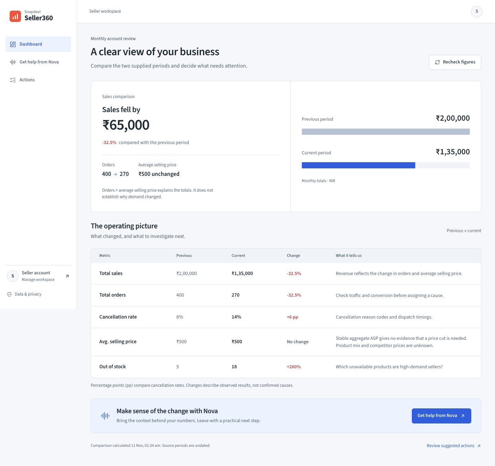

# Seller360

A voice-first seller account review workspace built by Akhil. Review performance, discuss concerns with Nova, and track agreed next steps.



**React · TypeScript · Express · Gemini · Netlify**

An independent portfolio project using clearly disclosed sample seller data. It has no live Snapdeal marketplace connection and performs no marketplace transactions.

## Run locally

Requires Node.js 24 and npm. Create a Gemini API key in Google AI Studio, then:

```sh
npm install
cp .env.example .env
# Add GEMINI_API_KEY to .env. Never use a VITE_ variable for a secret.
npm run dev
```

The current project uses Gemini 3.1 Flash-Lite for Nova’s reasoning. It is configured server-side, with a bounded output and timeout. Google offers a free API tier, but quotas depend on the account/project and can change; this is not unlimited or guaranteed free capacity. Check the actual quota in AI Studio. No paid tier or billing is enabled by this project.

Exact Dashboard arithmetic remains deterministic and auditable. Gemini interprets the conversation and evidence; it does not invent replacement business figures. Browser-native recognition or on-device Whisper transcribes audio, and system speech synthesis reads replies. There is no local language-model process in the cloud configuration; on-device transcription can still use device resources.

For a production-style local run use npm run build then npm start. Optional providers remain supported: LLM_PROVIDER=openai with OPENAI_API_KEY, or LLM_PROVIDER=ollama with Ollama installed and npm run ai:setup. Explicit LLM_PROVIDER=demo enables limited rules-only responses locally. Hosted AI failures return an error rather than silently pretending scripted responses are model analysis.

## Deploy on Netlify

netlify.toml builds the Vite frontend and an Express API function. Set GEMINI_API_KEY as a secret environment variable in Netlify’s Functions scope. Provider/model/runtime settings are declared in the config and can be overridden. Do not upload .env or server/.local.

Netlify Blobs persists each browser workspace independently, using conditional writes so instances do not simply overwrite each other. Calls retain up to 30 sessions and prune sessions older than 30 days on save. Tasks record local application work, never marketplace changes. The browser holds a separate cache of up to 20 finished calls. Workspace identity is an unguessable browser bearer identifier, not a multi-user account/login system; treat the public site as a sample-data portfolio demo, not a private seller-data service.

AI use is limited per workspace per hour and failures/quotas are visible. Platform free-plan quotas and provider quotas still apply. No paid hosting upgrade is required by this repository. See docs/DEPLOYMENT.md for the runtime contract and release checks.

## Conversation behaviour

- The model receives recent dialogue with speaker roles, exact calculated metrics, data limits, seller evidence, available actions and pending task state. It chooses how to answer the latest request. There is no turn-count script or preselected question to rewrite.
- Explanations, corrections, interruptions and thanks do not force the next step in a fixed sequence. Unclear speech should trigger clarification.
- Seller declarations retain exact quotes and distinguish reported issues, denied issues and uncertainty. Questions do not count as seller facts. Clear corrections replace earlier evidence.
- Plans use the model's selected action keys. Backend validation excludes inventory and dispatch actions contradicted by explicit seller denials. Proposals do not save tasks.
- Saving requires explicit approval of the pending plan. Refusal clears that state; thanks does not create another plan. All tasks remain within this application.
- Ending a session records the concern, metrics, evidence, recommendations, commitments and unknowns. Transcripts are persisted by the API during calls and retained for 30 days. Completed calls appear as saved conversations with a summary; active sessions can resume after a restart.

## Architecture and data

React/TypeScript/Vite calls an Express API. analytics.ts calculates changes from two monthly aggregates. llm.ts integrates Ollama, Gemini GenerateContent and OpenAI Responses with validated structured output. agent.ts maintains evidence, sessions, task approval and summaries. recommendations.ts defines available local actions. store.ts scopes sessions by browser demo ID and persists tasks and conversations to server/.local/actions.json and server/.local/conversations.json locally, or owner-scoped Netlify Blobs in hosted mode.

The observed dataset contains sales ₹200,000 → ₹135,000, orders 400 → 270, ASP ₹500 → ₹500, cancellations 8% → 14%, and stockouts 5 → 18. Traffic, conversion, cancellation reasons, product demand and competitor prices are unknown unless the seller reports them. Correlation does not establish a single root cause or causal contribution. Model replies can still contain mistakes; provider readiness does not guarantee correctness.

## Voice

Browser speech recognition is used where available. If its hosted service fails, the app records utterances and runs quantized Whisper Tiny locally through Transformers.js and ONNX Runtime WebAssembly. The fallback model downloads on first use and is cached by the browser. Its recorded audio remains on-device; browser-provided recognition may use the vendor's hosted service. Only the resulting transcript is sent to the application API and configured reasoning provider. Browser SpeechSynthesis reads replies while the microphone is paused. English/Hindi, mute and typed input remain supported. Recognition accuracy depends on device, accent and background noise.

## Verification

```sh
npm run typecheck
npm test
npm run build
# Real model exercise against a running API:
node scripts/eval-conversation.mjs
```

Automated tests cover calculations, API validation/scoping, voice lifecycle, conversational interruptions, context corrections, task refusal/approval, model-driven decisions, dialogue history and model outages. The live exercise runs the original problematic transcript and reordered questions against the actual model. It creates isolated local test-owner tasks; it does not alter the user's action list. Semantic quality needs inspection of the generated replies in addition to passing deterministic assertions.

## API

GET /api/health, /api/seller/performance, /api/seller/insights, /api/actions, /api/agent/history

POST /api/agent/start, /api/agent/turn, /api/agent/end, /api/actions

PATCH /api/actions/:id

This is a single-user demonstration, with mock data and local persistence. It does not perform marketplace operations or guarantee revenue recovery.

## Voice call interface

Navigation has three entries: Dashboard, Get help from Nova, and Actions. Dashboard includes the former Stats comparisons. Old /analytics links redirect to Dashboard.

Live calls show a single Nova call surface with listening, thinking and speaking states. No live message bubbles or duplicate pending messages appear. Optional captions show only the current reply; keyboard input is a fallback. The full transcript and business summary are shown after ending the call and in Saved calls.

One brief spoken thinking cue plays after 1.8 seconds of an actual seller-question request, never before the greeting, and stops before the reply. It respects mute and does not enter the transcript. Recognition stays paused through cues and replies. Nova prefers an installed feminine English or Hindi voice by voice name and locale, and speaks at 1.16× speed. Voice availability and timbre depend on the browser and OS; Web Speech does not expose gender metadata.

## Lower-load local use (8 GB laptops)

Run npm run build once, then npm start and open http://127.0.0.1:3001. Stop the development command in its terminal when using this mode, so Vite and file watchers are not running alongside the production server. These changes do not select a different model, require a paid API, or change credentials.

- The call screen has no idle animation. The dashboard uses accessible CSS comparisons instead of shipping a chart engine for two totals.
- Local transcription runs in a dedicated worker with one WASM thread. Silent segments skip inference. Ending a call or leaving its page terminates the worker and releases model memory; downloaded model files remain cached.
- Ollama uses two CPU threads and a 60-second idle keep-alive. The selected 4B model still needs roughly 3.8 GB while loaded; it unloads after idle and takes longer to load on the next request. The 8K context and selected model are preserved.
- The first speech-model download can take a while. Browser-native speech is tried first; the on-device fallback stays available when that service fails.
- A cloud provider can move language-model computation off the laptop, but requires separate provider setup and may have usage limits or charges. It has not been enabled by this change.

See docs/verification-nova-performance.md for actual measurements and limitations.

## Interface and browser verification

The deliberate light theme uses cobalt #315FDB for interactions and coral only in the logo. Brave Auto Dark Mode had caused the earlier dark screenshot; the new interface was checked in actual Brave without changing its browser settings. Source Sans 3 is self-hosted under its included OFL license.

Suggestions now belongs to Actions; /growth redirects there. Saved calls belongs to Nova. Account data, source limitations and local storage behavior are explained once in Data & privacy. Recheck figures recalculates supplied totals, not marketplace freshness.

A reusable browser check uses the existing Playwright dependency. Run it against an isolated local API storage directory, with the ordinary server on a different port:

```sh
PORT=3101 SELLER360_DATA_DIR=test-results/redesign/runtime npm start
# In another terminal:
SELLER360_QA_URL=http://127.0.0.1:3101 node scripts/verify-ui.cjs
```

The check visits seven screens at five widths, captures screenshots, asserts overflow/navigation/reduced-motion behavior, verifies task persistence and keyboard focus, and injects controlled failures/cancellation responses. Task mutation checks use a new browser workspace identifier. See docs/verification-redesign.md for the completed redesign, measured active voice resources and remaining limits. The earlier performance note describes the pre-redesign implementation.
